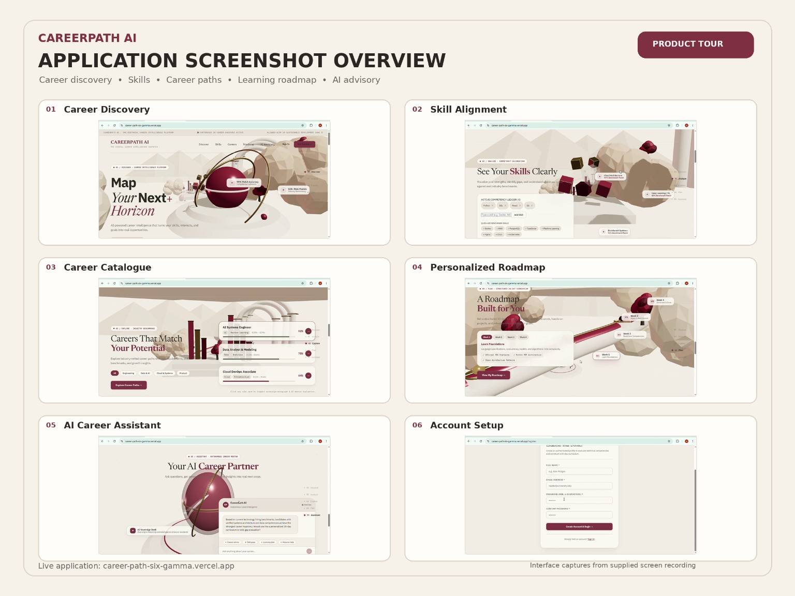

# CareerPath AI

### Find Your Direction. Build Your Skills. Shape Your Future.

**CareerPath AI** is an AI-powered career intelligence platform designed to help students and aspiring professionals explore career opportunities, understand skill gaps, and build structured learning roadmaps toward their career goals.

Rather than leaving users overwhelmed by endless career options and disconnected learning resources, CareerPath AI brings career discovery, skill alignment, personalized planning, and AI-assisted guidance into one platform.

<p align="center">
  <a href="https://career-path-six-gamma.vercel.app/">
    <strong>🌐 Live Application</strong>
  </a>
  &nbsp; · &nbsp;
  <a href="https://github.com/Burhanuddinsiddikwala/Career-path">
    <strong>📂 Source Code</strong>
  </a>
</p>

---

## ✨ Key Features

| Feature | Description |
|---|---|
| 🧭 **Career Discovery** | Explore career opportunities and understand potential professional directions. |
| 🎯 **Skill Alignment** | Compare your existing competencies with the skills associated with your career goals. |
| 📚 **Career Catalogue** | Discover career options and explore the skills and requirements associated with them. |
| 🗺️ **Personalized Roadmaps** | Organize your learning journey into structured steps toward a target career. |
| 🤖 **AI Career Assistant** | Get career-related guidance and assistance through the application's AI capabilities. |
| 👤 **User Authentication** | Access the application through account registration and sign-in. |
| 📈 **Career Development** | Bring career exploration, competency development, and learning plans into one workflow. |

## 🖥️ Application Preview

Explore the live application to experience its interface and career-planning workflow.

**Live demo:** [CareerPath AI](https://career-path-six-gamma.vercel.app/)

<p align="center">
  
</p>

---

## 🛠️ Technology Stack

CareerPath AI uses a full-stack architecture that separates the user interface, backend services, and data storage.

### Frontend

- **React 19** — Component-based user interface.
- **Vite** — Development server and production build tooling.
- **Tailwind CSS** — Utility-first interface styling.
- **JavaScript** — Application logic and client-side interactions.

### Backend

- **Python** — Backend application logic.
- **Flask** — REST API and server-side application services.
- **Gunicorn** — Production WSGI server for deployment.

### Data and AI

- **SQLite** — Relational data storage.
- **Gemini integration** — AI-assisted functionality when the provider is configured.
- **Fallback logic** — Rule-based or heuristic responses where supported by the application, helping provide graceful behavior when an external AI provider is unavailable.

### Deployment and Development

- **Vercel** — Frontend hosting.
- **Render** — Backend hosting.
- **Git and GitHub** — Version control and source-code management.

---

## 🏗️ System Architecture

The application follows a frontend–backend architecture.

```text
┌──────────────────────────────┐
│           User               │
└──────────────┬───────────────┘
               │
               ▼
┌──────────────────────────────┐
│       React + Vite           │
│       Frontend on Vercel     │
└──────────────┬───────────────┘
               │ HTTPS / REST API
               ▼
┌──────────────────────────────┐
│         Flask API            │
│       Backend on Render      │
└────────┬─────────────┬───────┘
         │             │
         ▼             ▼
┌────────────────┐  ┌────────────────┐
│  SQLite        │  │  AI Services    │
│  Data Storage  │  │  + Fallbacks    │
└────────────────┘  └────────────────┘
```

### How it works

1. Users interact with the React frontend to explore careers and manage their career-planning workflow.
2. The frontend sends relevant requests to the Flask backend through the configured API URL.
3. The backend processes requests and interacts with the database or available AI functionality as required.
4. The application returns structured responses for the frontend to display.
5. The frontend and backend can be deployed independently, allowing each layer to be maintained and updated separately.

---

## 🚀 Getting Started

Follow these steps to run CareerPath AI locally.

### Prerequisites

Install the following before starting:

- [Node.js](https://nodejs.org/) and npm
- [Python](https://www.python.org/)
- [Git](https://git-scm.com/)

### 1. Clone the repository

```bash
git clone https://github.com/Burhanuddinsiddikwala/Career-path.git
cd Career-path
```

### 2. Configure the backend

Open a terminal in the project root:

```bash
cd backend
python -m venv .venv
```

Activate the virtual environment.

**Windows PowerShell:**

```powershell
.\.venv\Scripts\Activate.ps1
```

**Windows Command Prompt:**

```cmd
.venv\Scripts\activate.bat
```

Install the backend dependencies:

```bash
pip install -r requirements.txt
```

Configure the backend environment variables according to the project's `.env.example` or existing configuration instructions. Add an AI provider key only if required for the functionality you intend to use.

Start the backend using the Flask entry point and startup command defined by the project. For example, if the application entry point is `app.py`:

```bash
python app.py
```

Use the actual entry point and port specified in the repository configuration.

### 3. Configure the frontend

Open a second terminal:

```bash
cd frontend
npm install
```

Create a local `.env` file in the frontend directory:

```env
VITE_API_URL=http://127.0.0.1:5000
```

Replace the URL or port if your backend uses a different address. The variable must match the API configuration expected by the frontend.

Start the development server:

```bash
npm run dev
```

Open the local URL printed by Vite in your terminal.

### 4. Build for production

From the frontend directory:

```bash
npm run build
```

Vite generates the production build in the `dist/` directory by default.

---

## 🔐 Environment Variables

Keep credentials and API keys out of source control.

| Variable | Purpose |
|---|---|
| `VITE_API_URL` | Base URL used by the frontend to communicate with the backend. |
| AI provider key | Enables the configured external AI integration, if required by the backend. |

Use the exact environment-variable names referenced in the backend source code and deployment configuration. The AI provider's variable name should be taken from the actual implementation rather than guessed.

**Security notes:**

- Never commit `.env` files containing secrets.
- Do not expose private API keys through `VITE_` variables. Vite-prefixed variables can be included in browser code.
- Configure production secrets through the backend hosting provider's environment settings.
- Ensure the deployed backend uses appropriate CORS rules and a persistent storage strategy for application data.

---

## ☁️ Deployment

### Frontend — Vercel

1. Import the GitHub repository into Vercel.
2. Set the frontend project root to `frontend` if the repository uses that structure.
3. Configure the build command as `npm run build`.
4. Configure the output directory as `dist`.
5. Set `VITE_API_URL` to the actual deployed backend URL.
6. Deploy or redeploy the application after updating environment variables.

### Backend — Render

1. Create a Python web service connected to the GitHub repository.
2. Configure the service root directory to `backend` if applicable.
3. Install dependencies using the repository's requirements file.
4. Configure the production startup command using the actual Flask entry point and Gunicorn configuration.
5. Add the required backend environment variables.
6. Configure CORS for the deployed frontend origin.
7. Verify the health endpoint and API routes after deployment.
8. Ensure database storage persists across service restarts and deployments.

> **Important:** Deployment settings depend on the actual repository structure and hosting configuration. Verify the configured commands and paths before applying them. A successful frontend deployment alone does not establish that the backend or authentication flow is working.

---

## 🧪 Testing and Quality

Before releasing changes, verify the following:

- [ ] Frontend production build completes successfully.
- [ ] Backend starts without runtime errors.
- [ ] API health endpoint responds correctly, if configured.
- [ ] User registration and login work with a valid test account.
- [ ] Invalid credentials are rejected appropriately.
- [ ] Frontend requests reach the correct backend.
- [ ] Database initialization and persistence work as intended.
- [ ] Career discovery, skill alignment, roadmaps, and AI assistance are regression-tested.
- [ ] Secrets and local database files are excluded from Git.

Run the test commands defined by the project and document any known limitations accurately.

---

## 🌱 Project Goals

CareerPath AI aims to make career planning more structured and accessible by bringing together:

- Career exploration and informed decision-making.
- Skill awareness and competency development.
- Step-by-step learning plans.
- AI-assisted career guidance.
- A unified digital experience for career development.

The long-term goal is to help users move from *“I don't know where to start”* to a clearer, more actionable career-development plan.

---

## 🗺️ Future Improvements

Potential directions for future development include:

- Resume parsing and skill extraction.
- More detailed skill-gap analysis.
- Curated learning resources and certifications.
- Progress tracking across roadmap milestones.
- Expanded career and industry datasets.
- Improved evaluation of AI-generated recommendations.
- More comprehensive automated testing and observability.

These are possible future enhancements, not claims that every feature is already implemented.

---

## 🤝 Contributing

Contributions, feedback, and ideas are welcome.

1. Fork the repository.
2. Create a feature branch.

   ```bash
   git checkout -b feature/your-feature
   ```

3. Commit your changes.

   ```bash
   git commit -m "Add: describe your change"
   ```

4. Push the branch.

   ```bash
   git push origin feature/your-feature
   ```

5. Open a pull request describing the change and its testing.

---

## 📄 License

No license is specified here. Add a `LICENSE` file and update this section once the project's intended license has been selected.

---

<p align="center">
  <strong>CareerPath AI</strong><br/>
  Turning career uncertainty into a more structured journey.
  <br/><br/>
  <a href="https://career-path-six-gamma.vercel.app/">Live Application</a>
  &nbsp; · &nbsp;
  <a href="https://github.com/Burhanuddinsiddikwala/Career-path">GitHub Repository</a>
</p>
